<div align="center">


# Dynamic Notch Island

A Dynamic Island for Windows and Linux, with Pal, your coding agent companion<br>
for Claude Code, Codex, Gemini CLI, Cursor and Copilot CLI.

[](https://github.com/Shafat21/DynamicNotch/releases)
[](https://github.com/Shafat21/DynamicNotch/releases)
[](https://github.com/Shafat21/DynamicNotch/stargazers)
[](LICENSE)


<br>

[](https://github.com/Shafat21/DynamicNotch/releases/latest)
[](https://github.com/Shafat21/DynamicNotch/releases/latest)

**Windows:** `.exe` installer &nbsp;·&nbsp; **Linux:** `.deb`, `.rpm`, `.AppImage`

</div>

---

A small pill sits at the top of your screen and shows the time. Hover it and it morphs into a dashboard;
when a coding agent needs you, Pal tells you and you can answer right from the island.

<p align="center">
  
</p>

<p align="center">
  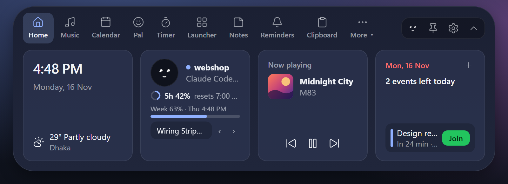
</p>

<p align="center">
  <a href="#install"><b>Install</b></a> ·
  <a href="#features">Features</a> ·
  <a href="#coding-agents">Coding agents</a> ·
  <a href="#dictation">Dictation</a> ·
  <a href="#build-from-source">Build</a> ·
  <a href="#data--privacy">Privacy</a>
</p>

> Architecture, internals and roadmap are in [plan.md](plan.md).

## Screenshots

<table>
  <tr>
    <td width="50%">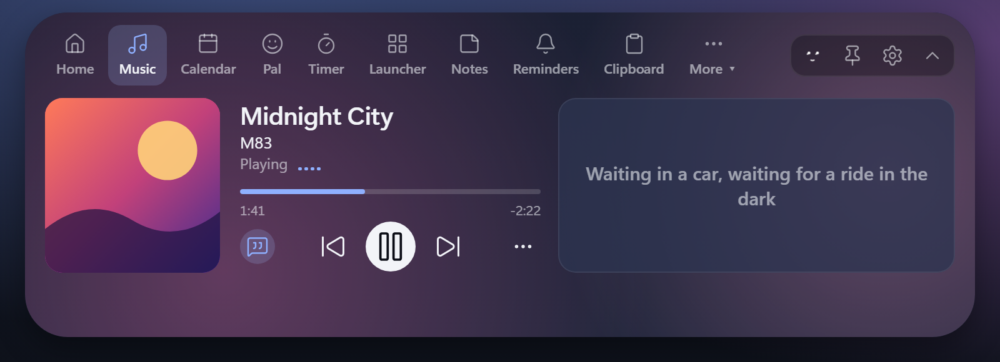<br><sub><b>Music</b>: album art, seek bar, synced lyrics</sub></td>
    <td width="50%">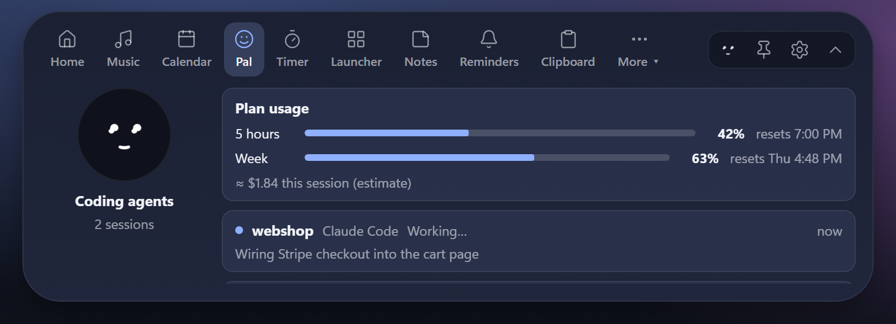<br><sub><b>Pal</b>: plan usage and every agent session</sub></td>
  </tr>
  <tr>
    <td>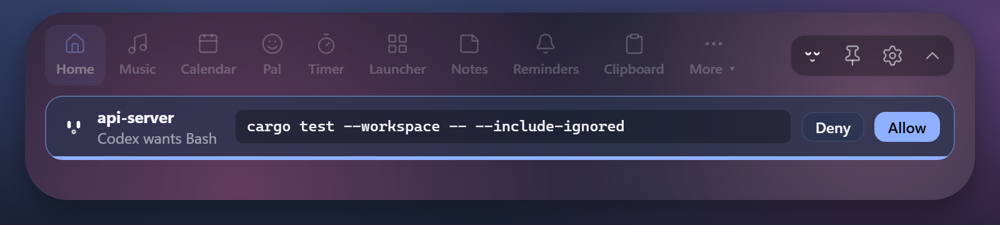<br><sub><b>Permission prompt</b>: allow or deny a Codex / Claude Code tool call</sub></td>
    <td>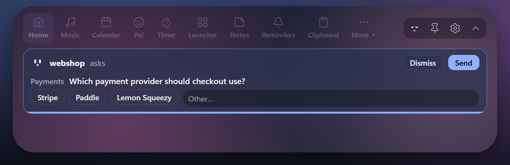<br><sub><b>Question</b>: answer Claude Code's AskUserQuestion</sub></td>
  </tr>
  <tr>
    <td>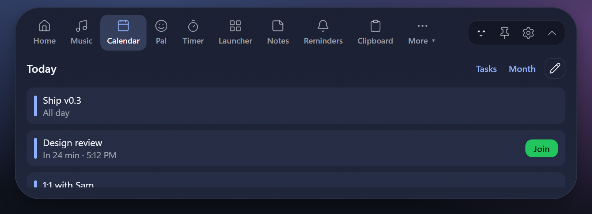<br><sub><b>Calendar</b>: today's agenda with Join buttons</sub></td>
    <td>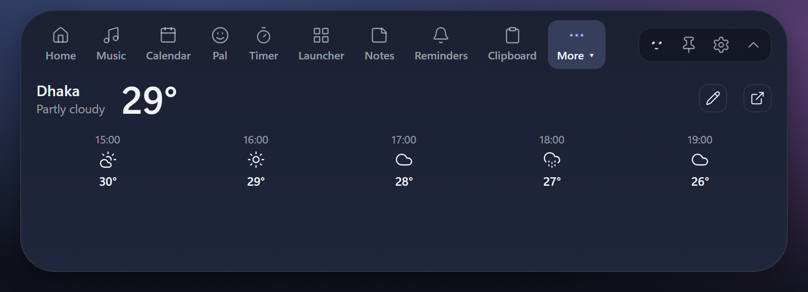<br><sub><b>Weather</b>: now and the next hours</sub></td>
  </tr>
  <tr>
    <td>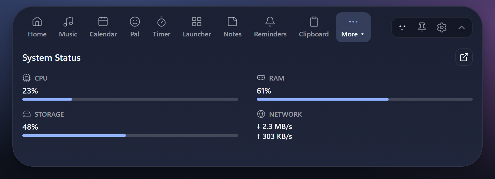<br><sub><b>System</b>: CPU, RAM, storage, network</sub></td>
    <td>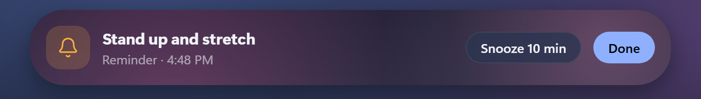<br><br><sub><b>Reminder</b> banner and the <b>dictation</b> pill</sub></td>
  </tr>
  <tr>
    <td>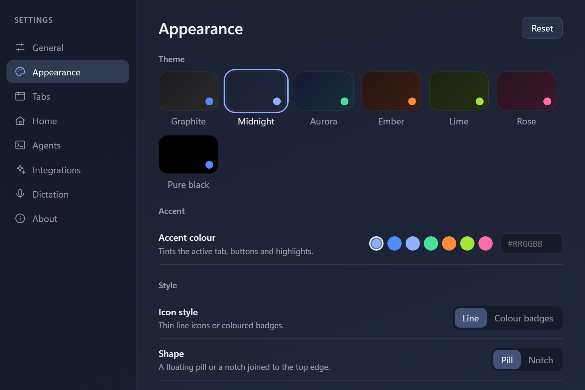<br><sub><b>Settings → Appearance</b>: 7 themes, accent, icons, shape</sub></td>
    <td>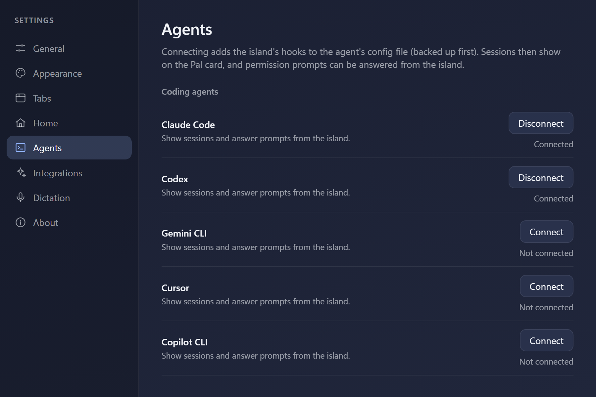<br><sub><b>Settings → Agents</b>: connect each coding agent</sub></td>
  </tr>
</table>

<sub>Screenshots use sample data.</sub>

## Features

**Dashboard (hover the island)** - a tab bar over these pages (tabs you can reorder or hide in Settings, extra ones go under **More**):
- **Home:** configurable cards (clock, Pal, music, calendar, launcher, focus, notes, reminders, and optional system, tasks, sound, devices, dictation).
- **Music player:** album art, title/artist, seek by click or drag, play/pause/next/prev, synced lyrics.
- **Calendar:** today's agenda from the **Windows Calendar app** (Outlook, Google, iCloud and Exchange accounts added there) and/or a private **iCal link**, merged in one list, with Join buttons for online meetings; events that already ended are dimmed.
- **Pal**, **Timer** (focus timer, 5 minute steps), **Weather**, **System stats** (CPU, RAM, storage, network), **Tasks**, **Month progress**.
- **Launcher dock:** pin apps and start them with one click; extra apps collapse into a +N overflow.
- **Notes** (pinnable) and **Reminders** with snooze / done and a chime.
- **Clipboard history:** text only, kept in memory by default (optional "remember across restarts"); copies that password managers mark as private are skipped (Windows).
- **Sound & brightness:** volume, mute, output device, per-display brightness.
- **Bluetooth devices:** radio on/off, connect / disconnect paired devices.
- **Shelf:** drop files on the island to park them; open, reveal, copy path, drag back out (Windows).

**Pal**
- An animated face with 8 moods: calm, happy, listening, thinking, needs-you, done, napping and broke.
- Lives in the idle pill next to the clock and on the assistant card; moods follow what your coding agents are doing.

**Coding agent companion**
- Works with **Claude Code, Codex, Gemini CLI, Cursor and Copilot CLI**; connect each one in Settings → Agents. See [Coding agents](#coding-agents).
- Live status of every session, labelled with its agent (working, waiting for you, done, error); a spinner in the idle pill while one works.
- Answer permission prompts (allow / deny) from the island for Claude Code, Codex and Copilot CLI, and Claude Code's multiple-choice questions.
- **Usage limits ring:** your Claude 5-hour and weekly plan usage with reset times, read from Claude Code's official `statusLine` `rate_limits`.

**Voice dictation**
- Hold **Ctrl+Win**, speak, release: the text is pasted into the focused app. Double-tap for hands-free, Esc cancels.
- Offline transcription with Meta Omnilingual ASR (1600+ languages, Bangla included, detected by itself) or NVIDIA
  Parakeet (25 European languages, faster), both via sherpa-onnx; or cloud via OpenAI or Groq. Dictionary, replacements,
  snippets and optional Claude clean-up; local history with words/min and streak. See [Dictation](#dictation).

**Settings window** (right-click the island → Settings…, or the ⚙ button)
- **General:** start at login, display, island size, hide in fullscreen, which tab opens first.
- **Appearance:** themes (Graphite, Midnight, Aurora, Ember, Lime, Rose, Pure black), accent colour, line or colour-badge icons,
  pill or notch shape, density, tab labels, corner radius, text size, card opacity and island sizes.
- **Tabs** and **Home:** reorder, show or hide tabs and Home cards.
- **Agents:** connect or disconnect each coding agent.
- **Integrations:** desktop calendar and iCal link, weather city, reminder sound, clipboard history, shelf, launcher apps, sound and Bluetooth shortcuts.
- **Dictation:** engine, model, hotkey, words and history.

**Fits your desktop**
- **Hides in fullscreen** games, videos and apps (Windows), and comes back when you leave fullscreen.
- **Choose the display** (primary or a specific screen) and **responsive scaling** that follows resolution,
  DPI and monitor changes (Island Size: Auto, Small, Medium, Large).
- **Caps Lock / Num Lock** indicators, **charging** animation and **notifications** in the island (Windows).
- **Click-through:** the desktop under the island stays usable; only the pill takes the mouse (Windows).

## Platform support

| Platform | Status |
|---|---|
| Windows 10 / 11 | ✅ Supported |
| Linux, GNOME | 🧪 Code present but untested; much is still stubbed (see below) |
| Linux, KDE Plasma | 🧪 Untested |
| macOS | ❌ Not supported |

Linux today: the window is placed but click-through/hover detection, media (MPRIS), notifications,
launcher, fullscreen detection, shelf drag-out and modifier-only dictation hotkeys are **not implemented**.
Sound (`wpctl`/`pactl`), brightness, Bluetooth (`bluetoothctl`) and clipboard history have best-effort code that has not
been compiled or run on real hardware. Dictation on Linux copies the text and you press Ctrl+V.

## Install

**Windows:** download `Dynamic Notch Island_<version>_x64-setup.exe` from the [latest release](https://github.com/Shafat21/DynamicNotch/releases/latest)
and run it. The installer isn't code-signed yet, so Windows SmartScreen may warn on first run ("Unknown publisher"): click **More info**, then **Run anyway**.

<table align="center">
  <tr>
    <td align="center">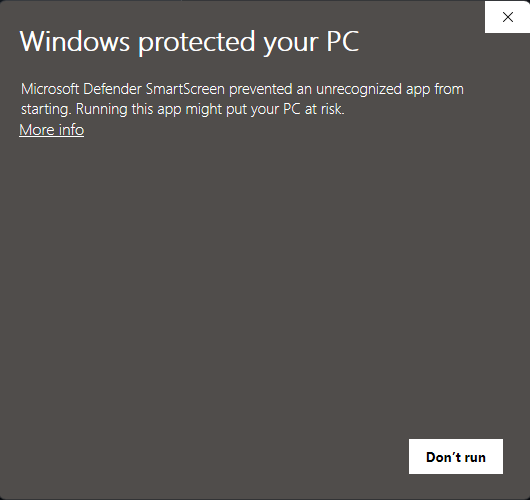<br><sub><b>1.</b> Click <b>More info</b></sub></td>
    <td align="center">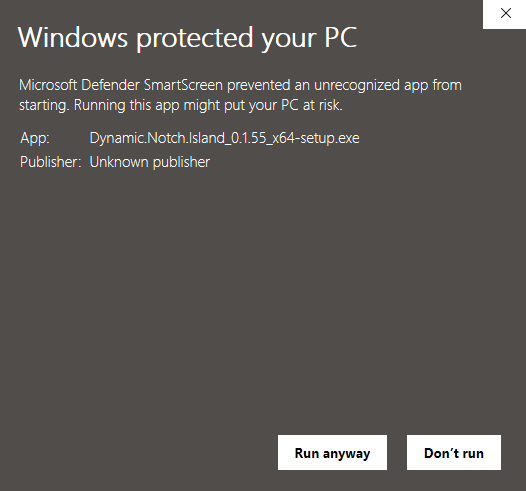<br><sub><b>2.</b> Click <b>Run anyway</b></sub></td>
  </tr>
</table>

**Linux:** download the package for your distro from the [latest release](https://github.com/Shafat21/DynamicNotch/releases/latest):

```bash
# Debian / Ubuntu
sudo apt install ./*.deb

# Fedora / openSUSE
sudo dnf install ./*.rpm

# Any distro
chmod +x *.AppImage
./*.AppImage
```

Linux builds are experimental, see [Platform support](#platform-support).

## Usage

| Action | What happens |
|---|---|
| Hover the island | Opens the dashboard |
| Click a tab | Opens its page (music, calendar, timer, ...) |
| Right-click | Menu: Settings…, Animation Style, Coding Agents (tick an agent to connect it), Quit (display, island size, autostart and fullscreen options live in Settings) |
| Allow / Deny on a prompt | Answers the agent; Enter = Allow / Send, Esc = Dismiss (the agent then asks in its terminal) |
| Wheel or ‹ › on the Pal card | Switch between agent sessions |
| ＋ in the launcher | Add an app |
| Right-click an app twice | Remove it from the launcher |
| ＋ on the calendar | Paste your iCal link (or turn on the desktop calendar in Settings → Integrations) |
| Click the circle on a task | Cross it off (click again within a second to undo) |

## Coding agents

Open **Settings → Agents** (or right-click the island → **Coding Agents**) and click **Connect** next to an agent.
A confirm dialog shows the file and the events first; the file is backed up as `<file>.dynamicnotch.bak`, and
**Disconnect** removes only what was added, leaving your own hooks alone.

| Agent | Config file | Sessions | Allow / deny from the island |
|---|---|---|---|
| Claude Code | `~/.claude/settings.json` | ✅ | ✅ plus multiple-choice questions |
| Codex | `~/.codex/hooks.json` | ✅ | ✅ |
| Copilot CLI | `~/.copilot/hooks/dynamic-notch.json` | ✅ | ✅ |
| Gemini CLI | `~/.gemini/settings.json` | ✅ | — (asks in its terminal) |
| Cursor | `~/.cursor/hooks.json` | ✅ | — (asks in its terminal) |

**How it works**
- **Claude Code** sends its hooks straight to a local endpoint on `127.0.0.1`, default port **47863** (configurable),
  protected by a random token. Its `statusLine` is set to `dynamic-notch.exe --statusline`, which feeds the usage ring and
  then runs your existing status line (chained), so yours keeps working; Disconnect restores it.
- **The other agents** can only run commands, so their hooks run `dynamic-notch.exe --hook --agent <name>`. This relay reads the
  agent's event, maps it onto the same events Claude Code sends, and forwards it to the same local endpoint. It reads the
  token from the app's database, so the token never goes into the agent's config file.
- **Never blocks an agent:** if the island isn't running the relay exits at once, and nothing is ever allowed without your click.
  Prompts wait **15 seconds** in the island (and are skipped while a fullscreen app is in front); then the agent asks in its terminal as usual.
- **Codex** asks you to review and trust new hooks once (`/hooks` in Codex).
- Usage limits are Claude only: they need a Claude Pro/Max plan and an open Claude Code session (Claude Code only reports `rate_limits` then).
- Nothing leaves your machine.

## Dictation

- **Setup:** Settings → Integrations → Dictation → Offline model → **Download** (about 670 MB, once; SHA-256 verified). Or choose
  OpenAI/Groq and add your API key. Then hold **Ctrl+Win** (changeable) and speak; two quick taps keep listening until the next press.
- **Text:** dictionary (always-spell words), replacements, snippets (say a trigger phrase, paste a text) and an optional
  clean-up (Natural / Polished) by your own Claude Code login (`claude -p`; only the text is sent). Off by default.
- **History & stats:** Settings → Dictation (search, copy, delete; words dictated, words/min, days in a row, top apps), stored in the local database.
- **Privacy:** dictation and voice-note audio stays in memory and is never written to disk; temporary call audio (Notetaker)
  is written to the app data folder and deleted after processing. The API key is stored in Windows Credential Manager
  (Secret Service on Linux), not in the database. With cloud dictation the audio is sent to the provider you chose.
- **Memory:** the offline model needs about 1 GB of RAM, so it loads when you start dictating (while you speak) and is freed after
  5 idle minutes. Nothing is loaded at startup. The first dictation after a long pause may take a second or two longer.
- **Build:** the offline engine links sherpa-onnx (with onnxruntime) statically; its prebuilt libraries are downloaded during the first `cargo build`.
- **Voice notes:** the mic button in the Notes editor and on the Home notes input (click to start/stop, or hold) inserts the text at the caret.
- **Notetaker:** "Record a call" (Notes tab or the island's top bar) records your microphone and the computer's sound (up to 3 h)
  into temporary files in the app data folder. On Stop it transcribes offline ("You" / "Them"), asks your Claude Code login for a
  summary, key points and to-dos only if you tick "Summarise with Claude" (off by default; transcript only otherwise) and saves
  a call note; the audio files are then deleted (leftovers from a crash are removed at the next start). Tell the people in the
  call you're recording.

## Build from source

**Windows:** [Rust](https://rustup.rs) (MSVC toolchain), [Node.js](https://nodejs.org) 20+, WebView2
(built into Windows 11).

**Linux (Debian/Ubuntu):** Rust, Node.js 20+, and:

```bash
sudo apt install libwebkit2gtk-4.1-dev libgtk-layer-shell-dev build-essential curl wget file \
  libssl-dev libayatana-appindicator3-dev librsvg2-dev libasound2-dev
```

Then:

```bash
git clone https://github.com/Shafat21/DynamicNotch.git
cd DynamicNotch
npm install
npm run tauri dev      # run in development
npm run tauri build    # installers in src-tauri/target/release/bundle/
cd src-tauri && cargo test
```

Dual-booting to test on Linux? See [plan.md](plan.md).

## Releasing

Every commit carries its own version, `0.1.<commit number>`: a pre-commit hook (`.githooks/pre-commit`, installed by `npm install`)
writes it into `package.json`, `package-lock.json`, `tauri.conf.json`, `Cargo.toml` and `Cargo.lock`.

To release, tag a commit and push the tag; GitHub Actions runs the tests and builds Windows and Linux packages into a **draft release**:

```bash
git tag v0.1.55              # the version of that commit (see package.json)
git push origin v0.1.55
```

Then open the draft on the Releases page, edit it with the pencil icon (don't start a new release), and publish.
Repository setting needed once: **Settings → Actions → General → Workflow permissions → Read and write**.

## Data & privacy

- Settings, tasks, notes, reminders, launcher apps, shelf entries and (only if you enable it) clipboard history are stored locally in SQLite:
  - Windows: `%APPDATA%\com.dynamicnotch.app\dynamic_notch.db`
  - Linux: `~/.local/share/com.dynamicnotch.app/dynamic_notch.db`
- Network calls: **Open-Meteo** (weather and city search), **LRCLIB** (lyrics; sends artist and title only),
  **your calendar link**, **your chosen dictation provider** (OpenAI or Groq, only when cloud dictation is used) and
  **Hugging Face** (only when you download the offline dictation model). The calendar link stays on your machine.
- **Claude Code (Anthropic)**, through your own `claude` login, both opt-in: the dictation clean-up (Natural / Polished) sends
  the dictated text, and "Summarise with Claude" in the Notes call panel sends call transcripts (both sides of the call).
  Audio is never sent.
- Call recordings: temporary WAV files in `%APPDATA%\com.dynamicnotch.app\notetaker\` (Linux:
  `~/.local/share/com.dynamicnotch.app/notetaker/`), deleted after processing, on cancel, on exit and at the next start.
- The desktop calendar is read locally through Windows' appointment store (read-only); nothing from it is sent anywhere.
- Connecting a coding agent edits only that agent's config file (backed up first), and only after you confirm.
- No accounts, no telemetry.

## Star History

<a href="https://www.star-history.com/?type=date&repos=Shafat21%2FDynamicNotch">
 <picture>
   <source media="(prefers-color-scheme: dark)" srcset="https://api.star-history.com/chart?repos=Shafat21/DynamicNotch&type=date&theme=dark&legend=top-left" />
   <source media="(prefers-color-scheme: light)" srcset="https://api.star-history.com/chart?repos=Shafat21/DynamicNotch&type=date&legend=top-left" />
   
 </picture>
</a>

## Credits

Weather by [Open-Meteo](https://open-meteo.com), lyrics by [LRCLIB](https://lrclib.net).
Offline speech recognition by [sherpa-onnx](https://github.com/k2-fsa/sherpa-onnx) (Apache-2.0) with NVIDIA's
[Parakeet TDT 0.6B v3](https://huggingface.co/nvidia/parakeet-tdt-0.6b-v3) (CC BY 4.0) and Meta's
[Omnilingual ASR](https://github.com/facebookresearch/omnilingual-asr) 1B CTC (Apache-2.0).
Portions of the dictation and notetaker code adapted from Coucou (https://github.com/Louis-CFM/coucou), © 2026 Louis Raillé, MIT License.
Full license texts: [THIRD_PARTY_NOTICES.md](THIRD_PARTY_NOTICES.md).

## License

[Apache-2.0](LICENSE)
